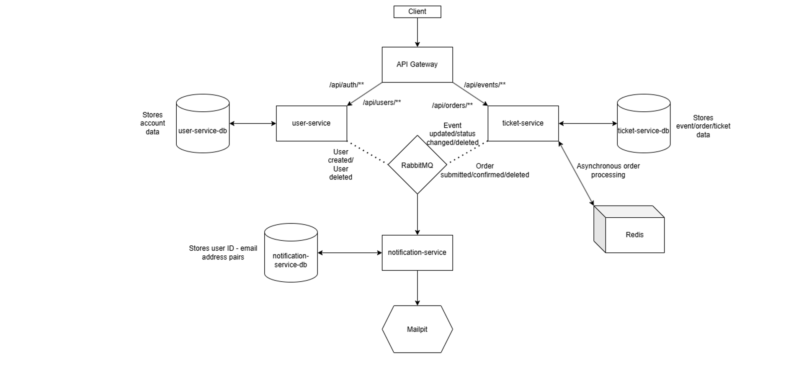

# ms-tickets

A project of a microservices-based platform built for event management.

---

## Architecture

*Figure 1: ms-tickets System Architecture*
---

## Tech Stack

* **Language & Core Framework:** Java 25, Spring Boot 4, Spring Cloud Gateway
* **Messaging:** Redis Streams (Order processing), RabbitMQ (Communication between services)
* **Security & Auth:** Spring Security, JJWT
* **Database & Persistence:** PostgreSQL, Spring Data JPA
* **API Standards:** REST, HATEOAS (HAL format)
* **Build & Tooling:** Gradle, Docker / Docker Compose
---

## Features

* **API Gateway:** Handles routing and JWT authentication.
* **Asynchronous Order Processing:** Uses **Redis Streams** with consumer groups to process ticket reservations reliably.
* **HATEOAS Integration:** Standardized REST responses featuring hypermedia links for discoverability.
* **Built-in super-administrator account:** A configurable account with system-wide management privileges has been provided.
* **Email notification system:** Users receive an email notification each time an event related to their account / order has occurred:
1. Orders: submitted / confirmed / deleted 
2. Events: updated / status changed / deleted
3. Account: registered / deleted 
---

## API Endpoints & Usage Guide

All endpoints are exposed through the API Gateway at `http://localhost:8080`.

---

## 1. user-service (`/api/auth`, `/api/users`)

Handles user authentication, account management and registration.

#### Authentication Endpoints (`/api/auth`)

##### `POST /api/auth/register`
Registers a new standard user (`ROLE_USER`).

* **Request:**
```http
POST /api/auth/register HTTP/1.1
Host: localhost:8080
Content-Type: application/json

  {
    "username": "user",
    "email": "user@example.com",
    "password": "secure_password"
  }
 ```

* **Response (`201 Created`)**
```json
{
  "id": 1,
  "username": "user",
  "email": "user@example.com",
  "role": "USER"
}
```
---
#### `POST /api/auth/login`
Authenticates a user and generates a JWT token.

* **Request:**
```http
POST /api/auth/login HTTP/1.1
Host: localhost:8080
Content-Type: application/json

{
    "username": "user",
    "password": "secure_password"
}
```
* **Response (`200 OK`):**
``` json
{
    "token": "eyJhbGciOiJIUzI1NiJ9.eyJzdWIiOiIxIiwidXNlcm5hbWUiOiJqb2huX2RvZSIsInJvbGUiOiJST0xFX1VTRVIifQ...",
}
```

#### User Management Endpoints (`/api/users`)

#### `GET /api/users`
Retrieves a list of users.

* **Request:**
```http
GET /api/users HTTP/1.1
Host: localhost:8080
Authorization: Bearer <JWT_TOKEN>
```

* **Response (`200 OK`):**
``` json
{
    "_embedded": {
        "users": [
            {
                "_links": {
                    "self": {
                        "href": "http://localhost:8080/api/users/1"
                    },
                    "users": {
                        "href": "http://localhost:8080/api/users"
                    },
                    "delete": {
                        "href": "http://localhost:8080/api/users/1"
                    }
                },
                "id": 1,
                "username": "admin",
                "email": "admin@example.com",
                "role": "SUPER_ADMIN"
            }
        ]
    },
    "_links": {
        "self": {
            "href": "http://localhost:8080/api/users?page=0&size=20"
        }
    },
    "page": {
        "number": 0,
        "size": 20,
        "totalElements": 1,
        "totalPages": 1
    }
}
```
---
#### `GET /api/users/{id}`
Retrieves details for a specific user by `id`.

* **Request:**
```http
GET /api/users/1 HTTP/1.1
Host: localhost:8080
Authorization: Bearer <JWT_TOKEN>
```
* **Response (`200 OK`):**
``` json
{
    "_links": {
        "self": {
            "href": "http://localhost:8080/api/users/1"
        },
        "users": {
            "href": "http://localhost:8080/api/users"
        },
        "delete": {
            "href": "http://localhost:8080/api/users/1"
        }
    },
    "id": 1,
    "username": "admin",
    "email": "admin@example.com",
    "role": "SUPER_ADMIN"
}
```
---
#### `GET /api/users/username/{username}`
Retrieves details for a specific user by `username`.
* **Request:**
```http
GET /api/users/username/admin HTTP/1.1
Host: localhost:8080
Authorization: Bearer <JWT_TOKEN>
```
* **Response (`200 OK`):**
``` json
{
    "_links": {
        "self": {
            "href": "http://localhost:8080/api/users/1"
        },
        "users": {
            "href": "http://localhost:8080/api/users"
        },
        "delete": {
            "href": "http://localhost:8080/api/users/1"
        }
    },
    "id": 1,
    "username": "admin",
    "email": "admin@example.com",
    "role": "SUPER_ADMIN"
}
```
---
#### `POST /api/users/register-admin`
Registers a new administrator (`ROLE_ADMIN`). Requires `SUPER_ADMIN` role.

* **Request:**
```http
POST /api/users/register-admin HTTP/1.1
Host: localhost:8080
Authorization: Bearer <JWT_TOKEN>
Content-Type: application/json

{
  "username": "new_admin",
  "email": "newadmin@example.com",
  "password": "AdminPassword123!"
}
```
* **Response (`200 OK`):**
``` json
{
  "id": 2,
  "username": "new_admin",
  "email": "newadmin@example.com",
  "role": "USER"
}
```
---
#### `DELETE /api/users/{id}`
Deletes a user by `ID`. Requires `ADMIN` or `SUPER_ADMIN` role.

* **Request:**
```http
DELETE /api/users/2 HTTP/1.1
Host: localhost:8080
Authorization: Bearer <JWT_TOKEN>
```
* **Response (204 `No Content`)**

## 2. ticket-service (`/api/events`, `/api/orders`)
Handles event and order creation and management.

### Order Processing Endpoints (`/api/orders`)

#### `POST /api/orders`
Submits a ticket booking request. Pushes the request to Redis Streams for asynchronous execution.

* **Request:**
```http
POST /api/orders HTTP/1.1
Host: localhost:8080
Authorization: Bearer <JWT_TOKEN>
Content-Type: application/json

{
    "eventId": 1,
    "ticketQuantity": 2
}
```
* **Response (202 `Accepted`)**
```json
{
    "_links": {
      "self": {
        "href": "http://localhost:8080/api/orders/1"
      },
      "user-orders": {
        "href": "http://localhost:8080/api/orders"
      },
      "user-orders-admin": {
        "href": "http://localhost:8080/api/orders/admin/1"
      },
      "status": {
        "href": "http://localhost:8080/api/orders/1/status"
      },
      "user-cancel": {
        "href": "http://localhost:8080/api/orders/1"
      },
      "admin-cancel": {
        "href": "http://localhost:8080/api/orders/admin/1"
      },
      "event": {
        "href": "http://localhost:8080/api/events/1"
      }
    },
    "id": 1,
    "userId": 1,
    "eventId": 1,
    "orderStatus": "PENDING",
    "tickets": []
}
```
---
#### `GET /api/orders`
Retrieves a paginated list of all orders belonging to the currently authenticated user.

* **Request:**
```http
GET /api/orders HTTP/1.1
Host: localhost:8080
Authorization: Bearer <JWT_TOKEN>
```
* **Response (200 `OK`)**
```json
{
    "_embedded": {
        "orders": [
            {
                "_links": {
                  "self": {
                    "href": "http://localhost:8080/api/orders/1"
                  },
                  "user-orders": {
                    "href": "http://localhost:8080/api/orders"
                  },
                  "user-orders-admin": {
                    "href": "http://localhost:8080/api/orders/admin/1"
                  },
                  "status": {
                    "href": "http://localhost:8080/api/orders/1/status"
                  },
                  "user-cancel": {
                    "href": "http://localhost:8080/api/orders/1"
                  },
                  "admin-cancel": {
                    "href": "http://localhost:8080/api/orders/admin/1"
                  },
                  "event": {
                    "href": "http://localhost:8080/api/events/1"
                  }
                },
                "id": 1,
                "userId": 1,
                "eventId": 1,
                "orderStatus": "CONFIRMED",
                "tickets": [
                    {
                        "code": "7815a0c2-eda4-4125-a7a3-f7a6ba4a0e03"
                    },
                    {
                        "code": "4ac67ec2-7f70-4f66-bbe8-831399a25dcb"
                    }
                ]
            }
        ]
    },
    "_links": {
        "self": {
            "href": "http://localhost:8080/api/orders?page=0&size=20"
        }
    },
    "page": {
        "number": 0,
        "size": 20,
        "totalElements": 1,
        "totalPages": 1
    }
}
```
---
#### `GET /api/orders`
Retrieves details of a specific order for the authenticated user.

* **Request:**
```http
GET /api/orders HTTP/1.1
Host: localhost:8080
Authorization: Bearer <JWT_TOKEN>
```
* **Response (200 `OK`)**
```json
{
    "_links": {
      "self": {
        "href": "http://localhost:8080/api/orders/1"
      },
      "user-orders": {
        "href": "http://localhost:8080/api/orders"
      },
      "user-orders-admin": {
        "href": "http://localhost:8080/api/orders/admin/1"
      },
      "status": {
        "href": "http://localhost:8080/api/orders/1/status"
      },
      "user-cancel": {
        "href": "http://localhost:8080/api/orders/1"
      },
      "admin-cancel": {
        "href": "http://localhost:8080/api/orders/admin/1"
      },
      "event": {
        "href": "http://localhost:8080/api/events/1"
      }
    },
    "id": 1,
    "userId": 1,
    "eventId": 1,
    "orderStatus": "CONFIRMED",
    "tickets": [
        {
            "code": "7815a0c2-eda4-4125-a7a3-f7a6ba4a0e03"
        },
        {
            "code": "4ac67ec2-7f70-4f66-bbe8-831399a25dcb"
        }
    ]
}
```
---
#### `GET /api/orders/{orderId}/status`
Check the processing status of a submitted order.

* **Request:**
```http
GET /api/orders/1/status HTTP/1.1
Host: localhost:8080
Authorization: Bearer <JWT_TOKEN>
```
* **Response (200 `OK`)**
```json
{
  "orderId": 1,
  "orderStatus": "CONFIRMED"
}
```

#### `DELETE /api/orders/{orderId}`
Deletes an order as the owning user.

* **Request:**
```http
DELETE /api/orders/1/status HTTP/1.1
Host: localhost:8080
Authorization: Bearer <JWT_TOKEN>
```
* **Response (204 `No Content`)**
---
#### `DELETE /api/orders/admin/{orderId}`
Deletes an order with the `orderId` from the system. Requires ADMIN or SUPER_ADMIN role.

* **Request:**
```http
DELETE /api/orders/1/status HTTP/1.1
Host: localhost:8080
Authorization: Bearer <JWT_TOKEN>
```
* **Response (204 `No Content`)**
---
#### `GET /api/orders/admin/{userId}`
Retrieves a paginated list of all orders belonging to the user with id equal to `userId`.

* **Request:**
```http
GET /api/orders/admin/1 HTTP/1.1
Host: localhost:8080
Authorization: Bearer <JWT_TOKEN>
```

* **Response (200 `Ok`)**
```json
{
    "_embedded": {
        "orders": [
            {
                "_links": {
                  "self": {
                    "href": "http://localhost:8080/api/orders/1"
                  },
                  "user-orders": {
                    "href": "http://localhost:8080/api/orders"
                  },
                  "user-orders-admin": {
                    "href": "http://localhost:8080/api/orders/admin/1"
                  },
                  "status": {
                    "href": "http://localhost:8080/api/orders/1/status"
                  },
                  "user-cancel": {
                    "href": "http://localhost:8080/api/orders/1"
                  },
                  "admin-cancel": {
                    "href": "http://localhost:8080/api/orders/admin/1"
                  },
                  "event": {
                    "href": "http://localhost:8080/api/events/1"
                  }
                },
                "id": 1,
                "userId": 1,
                "eventId": 1,
                "orderStatus": "CONFIRMED",
                "tickets": [
                    {
                        "code": "7815a0c2-eda4-4125-a7a3-f7a6ba4a0e03"
                    },
                    {
                        "code": "4ac67ec2-7f70-4f66-bbe8-831399a25dcb"
                    }
                ]
            }
        ]
    },
    "_links": {
        "self": {
            "href": "http://localhost:8080/api/orders/admin/1?page=0&size=20"
        }
    },
    "page": {
        "number": 0,
        "size": 20,
        "totalElements": 1,
        "totalPages": 1
    }
}
```
#### Event Management Endpoints (`/api/events`)
Handles event catalog browsing, modifications, status changes, and deletion.

##### `GET /api/events`
Retrieves a paginated list of all events with HATEOAS hypermedia links.

* **Request:**
```http
GET /api/events HTTP/1.1
Host: localhost:8080
Authorization: Bearer <JWT_TOKEN>
```
* **Response (200 `Ok`)**
```json
{
    "_embedded": {
        "events": [
            {
                "_links": {
                    "self": {
                        "href": "http://localhost:8080/api/events/1"
                    },
                    "events": {
                        "href": "http://localhost:8080/api/events"
                    },
                    "update": {
                        "href": "http://localhost:8080/api/events/1"
                    },
                    "update-status": {
                        "href": "http://localhost:8080/api/events/1/status"
                    },
                    "delete": {
                        "href": "http://localhost:8080/api/events/1"
                    }
                },
                "id": 1,
                "name": "Rock Festival 2026",
                "price": 149.99,
                "startDate": "2026-10-15T16:00:00Z",
                "endDate": "2026-10-17T21:00:00Z",
                "status": "ACTIVE",
                "availableTickets": 498
            }
        ]
    },
    "_links": {
        "self": {
            "href": "http://localhost:8080/api/events?page=0&size=20"
        }
    },
    "page": {
        "number": 0,
        "size": 20,
        "totalElements": 1,
        "totalPages": 1
    }
}
```
---
##### `GET /api/events/{id}`
Retrieves detailed information for a specific event by `id`.

* **Request:**
```http
  GET /api/events/1 HTTP/1.1
  Host: localhost:8080
  Authorization: Bearer <JWT_TOKEN>
```
* **Response (200 `Ok`)**
```json
{
  "_links": {
    "self": {
      "href": "http://localhost:8080/api/events/1"
    },
    "events": {
      "href": "http://localhost:8080/api/events"
    },
    "update": {
      "href": "http://localhost:8080/api/events/1"
    },
    "update-status": {
      "href": "http://localhost:8080/api/events/1/status"
    },
    "delete": {
      "href": "http://localhost:8080/api/events/1"
    }
  },
  "id": 1,
  "name": "Rock Festival 2026",
  "price": 149.99,
  "startDate": "2026-10-15T16:00:00Z",
  "endDate": "2026-10-17T21:00:00Z",
  "status": "ACTIVE",
  "availableTickets": 498
}
```
---
##### `POST /api/events`
Creates a new event with `SALES_CLOSED` status. Returns a Location header pointing to the newly created resource. Requires ADMIN or SUPER_ADMIN role.

* **Request:**
```http
POST /api/events HTTP/1.1
Host: localhost:8080
Authorization: Bearer <JWT_TOKEN>
Content-Type: application/json
```
* **Response (201 `Created`)**
```json
{
  "_links": {
    "self": {
      "href": "http://localhost:8080/api/events/1"
    },
    "events": {
      "href": "http://localhost:8080/api/events"
    },
    "update": {
      "href": "http://localhost:8080/api/events/1"
    },
    "update-status": {
      "href": "http://localhost:8080/api/events/1/status"
    },
    "delete": {
      "href": "http://localhost:8080/api/events/1"
    }
  },
  "id": 1,
  "name": "Rock Festival 2027",
  "price": 149.99,
  "startDate": "2026-10-15T16:00:00Z",
  "endDate": "2026-10-17T21:00:00Z",
  "status": "SALES_CLOSED",
  "availableTickets": 500
}
```
---
##### `PUT /api/events/{id}`
Updates details of an existing event. Fields not included in the request body retain their values. Requires ADMIN or SUPER_ADMIN role.

* **Request:**
```http
PUT /api/events/1 HTTP/1.1
Host: localhost:8080
Authorization: Bearer <JWT_TOKEN>
Content-Type: application/json

{
  "name": "Updated Rock Festival 2026",
  "price": 200.00,
  "startDate": "2026-10-15T18:00:00+02:00",
  "endDate": "2026-10-17T23:00:00+02:00",
  "availableTickets": 1000
}
```
* **Response (200 `Ok`)**
```json
{
  "_links": {
    "self": {
      "href": "http://localhost:8080/api/events/1"
    },
    "events": {
      "href": "http://localhost:8080/api/events"
    },
    "update": {
      "href": "http://localhost:8080/api/events/1"
    },
    "update-status": {
      "href": "http://localhost:8080/api/events/1/status"
    },
    "delete": {
      "href": "http://localhost:8080/api/events/1"
    }
  },
  "id": 2,
  "name": "Updated Rock Festival 2027",
  "price": 200.00,
  "startDate": "2026-10-15T16:00:00Z",
  "endDate": "2026-10-17T21:00:00Z",
  "status": "SALES_CLOSED",
  "availableTickets": 1000
}
```
---
##### `PATCH /api/events/{id}/status`
Changes the status of an event (`ACTIVE`, `SALES_CLOSED`, `FINISHED`, `CANCELLED`). Requires ADMIN or SUPER_ADMIN role.
* **Request:**
```http
PATCH /api/events/1/status HTTP/1.1
Host: localhost:8080
Authorization: Bearer <JWT_TOKEN>
Content-Type: application/json

{
  "status": "CANCELLED"
}
```
* **Response (201 `Created`)**
```json
{
  "_links": {
    "self": {
      "href": "http://localhost:8080/api/events/1"
    },
    "events": {
      "href": "http://localhost:8080/api/events"
    },
    "update": {
      "href": "http://localhost:8080/api/events/1"
    },
    "update-status": {
      "href": "http://localhost:8080/api/events/1/status"
    },
    "delete": {
      "href": "http://localhost:8080/api/events/1"
    }
  },
  "id": 1,
  "name": "Rock Festival 2027",
  "price": 149.99,
  "startDate": "2026-10-15T16:00:00Z",
  "endDate": "2026-10-17T21:00:00Z",
  "status": "CANCELLED",
  "availableTickets": 500
}
```
---
##### `PATCH /api/events/{id}/status`
Changes the status of an event (`ACTIVE`, `SALES_CLOSED`, `FINISHED`, `CANCELLED`). Requires ADMIN or SUPER_ADMIN role.
* **Request:**
```http
DELETE /api/events/1 HTTP/1.1
Host: localhost:8080
Authorization: Bearer <JWT_TOKEN>
```
* **Response (204 `No Content`)**
---
### Getting Started & Running the Project
#### Prerequisites

Ensure you have the following installed on your machine:

* **Java 25**
* **Gradle 9.x** (or use the provided `./gradlew` wrapper)
* **Docker** & **Docker Compose**
---
#### 1. Environment Variables Setup

Basing on the provided `env.example` file, create an `.env` file or export the required environment variables locally before launching the applications.

#### 2. Running Supporting Infrastructure (Docker)
Start the required databases (PostgreSQL) and message broker (RabbitMQ / Redis) using Docker Compose:
```bash
docker-compose up -d
```

#### 3. Building and Running Services
You can run the microservices locally using Gradle wrapper or directly from your IDE:

##### Step 1: Start API Gateway
```bash
cd api-gateway
./gradlew bootRun
```

##### Step 2: Start Notification Service
```bash
cd notification-service
./gradlew bootRun
```

##### Step 3: Start User Service
```bash
cd user-service
./gradlew bootRun
```

##### Step 4: Start Ticket Service
```bash
cd ticket-service
./gradlew bootRun
```

#### 4. Accessing the System
All API requests should be routed through the API Gateway on port 8080.

### Running Tests
```bash
# Run tests inside a specific module
cd <module_name>
./gradlew test
```
